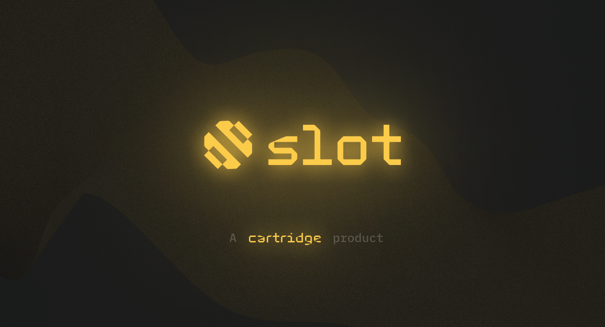

# Slot

Slot is the execution layer of Dojo, supporting rapid provisioning of low latency, dedicated, provable execution contexts, bringing horizontal scalability to the blockchain. It manages the sequencing, proving, and efficient settlement of its execution.

> [!IMPORTANT]
> Slot Katana and Torii deployments are discontinued. `slot deployments` no longer manages services; the CLI still manages auth, teams, paymasters, merkle drops, and RPC tokens.

## Installation

Install `slotup` to manage slot installations and follow the outputted directions.
```
curl -L https://slot.cartridge.sh | bash
```

## Usage

Authenticate with Cartridge
```sh
slot auth login
```

Manage collaborators with teams
```sh
slot teams <Team Name> list
slot teams <Team Name> add <Account Name>
slot teams <Team Name> remove <Account Name>
```

## Environment Variables

Slot CLI supports the following environment variables to control its behavior:

| Variable | Description |
|----------|-------------|
| `SLOT_DISABLE_AUTO_UPDATE` | When set, disables automatic updates. The CLI will still check for updates and notify you, but won't attempt to update automatically. |
| `SLOT_FORCE_AUTO_UPDATE` | When set, forces automatic updates without asking for confirmation. Useful for CI/CD environments. |
| `CARTRIDGE_API_URL` | Override the default Cartridge API URL. |
| `CARTRIDGE_KEYCHAIN_URL` | Override the default Cartridge Keychain URL. |
